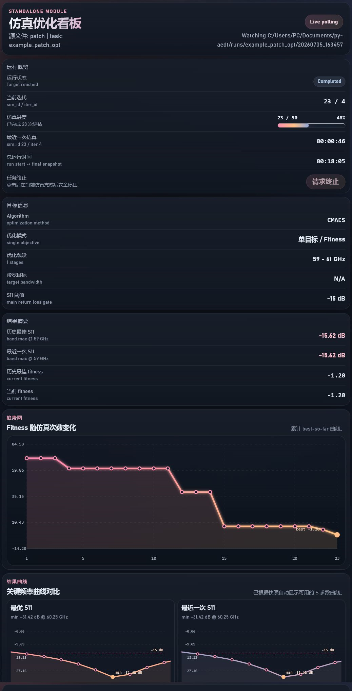

# hfss-harness

`hfss-harness` 是一套基于 PyAEDT 实现、面向 Ansys HFSS/AEDT 的 Python workflow harness，支持参数优化、扫参、固定参数验证、过孔建模，以及 PCB 导出与重建。

仓库内包含一个示例工程文件：`hfss/patch.aedt`，版本为 AEDT 2023 R2（2023.2）。实际运行需要本机准备可用的 AEDT/HFSS 环境和授权；仓库不包含 Ansys 软件、许可证、求解缓存或加工输出。

## 版本说明

- 当前版本：`0.2.0`，Alpha。
- 0.2.0 统一了优化、扫参和验证的案例执行流程，并新增沿指定线条自动布置过孔、从 AEDT 工程导出 Gerber，以及根据 Gerber、Drill 和叠层信息重建 AEDT 模型等 skills。
- 从旧版升级时，建议保留旧配置和运行目录；字段变化及支持范围见[0.2.0 迁移说明](docs/migration-0.2.0.md)，版本变化见[更新日志](CHANGELOG.md)。

## 核心功能

- 优化（`opt`）：支持 DE/JADE、CMA-ES、NSGA-II、Bayesian Optimization 和 PSO。
- 扫参（`sweep`）：支持逐变量扫参（OAT）、笛卡尔积组合（grid）和显式点集（explicit）。
- 单点验证（`val`）：验证一组或多组固定参数，可重新求解，也可只读已有结果。
- Dashboard：查看运行状态、参数、S 参数和结果快照。
- 只读预检：获取设计、变量、setup/sweep、对象和可用报告量。
- 参数与结果核验：检查参数写入/恢复、variation、频率单位、频带覆盖和必需指标。
- best 保存：按搜索仿真次数保存当前最优模型，结束时独立复验并导出。
- PCB 工作流：沿路径创建过孔，导出 Gerber/GKO/Drill 和叠层信息，按加工包重建几何与材料。

## 安装与依赖

基础要求：

- Python `>=3.11,<3.14`。
- 推荐使用 `uv` 管理环境。
- 需要已安装并授权的 Ansys Electronics Desktop / HFSS。
- 本版真实验证环境：Windows、AEDT 2023.2、PyAEDT 0.18.1、COM、non-GUI。其他 AEDT 版本、gRPC 和共享桌面复用尚未验证。

### 从源码安装

```powershell
git clone https://github.com/fangzh5/hfss-harness.git
cd hfss-harness
uv sync --extra hfss --extra cmaes
```

以上依赖可以运行本文的单点验证、扫参和 CMA-ES 示例。按需增加其他依赖：

```powershell
# 增加 PCB 导出与重建
uv sync --extra hfss --extra cmaes --extra cam

# 同时安装 BO 和开发依赖
uv sync --extra hfss --extra cmaes --extra cam --extra bo --extra dev
```

| Extra | 用途 |
| --- | --- |
| `hfss` | PyAEDT / AEDT 自动化 |
| `cmaes` | CMA-ES 优化 |
| `bo` | BoTorch Bayesian Optimization |
| `cam` | Gerbonara/Shapely，Gerber、板框和钻孔解析 |
| `dev` | pytest 等开发依赖 |

每次 `uv sync` 都列出本次需要的 extras。DE、JADE、PSO 和 NSGA-II 使用基础数值依赖。

### 从 wheel 安装

下载对应 Release 的 wheel，在已选好的 Python 环境中安装：

```powershell
python -m pip install "./hfss_harness-0.2.0-py3-none-any.whl[hfss,cmaes,cam]"
python -m optimizer.scaffold my_hfss_project
cd my_hfss_project
```

`scaffold` 会复制模板、标准模型、文档和五项公开 skills，遇到同名文件拒绝覆盖。安装包工作目录使用 `python -m optimizer.cli <config>`；下面源码示例中的 `uv run python` 相应改为 `python` 即可。

## Quick Start

### 方式 A：用 Codex 发起任务

在源码仓库或 `scaffold` 创建的目录中打开 Codex，可以直接说：

```text
先检查 hfss/patch.aedt，再执行一次单点验证（val）任务。
我要对 hfss/patch.aedt 执行一次扫参（sweep）任务。
我要对 hfss/patch.aedt 执行一次优化（opt）任务。
```

也可以换成自己的工程路径。如果没有自动匹配 skill，可以显式调用：

```text
$hh-sim，我要对 <你的 .aedt 文件路径> 执行一次优化（opt）任务。
```

`hh-sim` 会先读取工程信息，只询问仍缺失的参数、范围、目标和预算；已有明确授权可直接复用。启动前汇总具体配置，运行后检查实际结果、恢复和终态。

### 方式 B：手动运行标准示例

先只读预检，不求解、不保存原工程：

```powershell
uv run python -m optimizer.inspect_aedt hfss/patch.aedt --design base --setup Setup1 --sweep Sweep --aedt-version 2023.2 --temp-root temp --runs-root runs/inspection
```

对自己的工程，可以先省略未知的 design/setup/sweep，查看清单后再明确选择；缺选择返回 `needs_input`，不是已完成仿真。

先跑单点验证，再按需扫参或优化：

```powershell
# 名义参数单点验证
uv run python -m optimizer.cli configs/template_val.json

# patch_x 的三个点：1.00、1.01、1.02 mm
uv run python -m optimizer.cli configs/template_sweep.json

# 从已知达标点开始的 CMA-ES 链路示例
uv run python -m optimizer.cli configs/example_patch_opt.json
```

单点验证会检查 59–61 GHz 的 S11；结果有效但未达到 −10 dB，也属于正常的验证结果。优化示例初始点为 `patch_x=1.12 mm`、`patch_y=1.51 mm`，已在本版测试环境达到采样频带目标，并启用 `stop_on_target`，因此可能很快结束。它用于验证运行、评价和 best 保存链路，不代表一次新的搜索过程或所有环境都能复现相同数值。

Dashboard 界面示意，具体数值以当前任务输出为准：



### 用自己的模型

按任务复制对应模板，再修改配置：

| 任务 | 模板 | 主要字段 |
| --- | --- | --- |
| 优化 | `template_opt.json`、`template_bo.json`、`template_cmaes.json` | `parameters`、`target`、`algorithm` |
| 扫参 | `template_sweep.json` | `study.mode`、`study.variables` 或 `study.cases`，以及 `study` 内的评价设置 |
| 验证 | `template_val.json` | `cases`、`target`、`evaluation_mode` |

例如：

```powershell
Copy-Item configs/template_val.json configs/my_val.json
uv run python -m optimizer.cli configs/my_val.json
```

复制后先改工程路径、design/setup/sweep、实际变量名、取值、频带和目标，再运行。路径按模板所在配置目录解析；完整字段见[任务参考](docs/agent-reference.md)。扫参不需要搜索算法，验证不需要参数范围。

## 任务类型

### 优化（opt）

优化参数建议使用连续范围加量化精度：

```json
{"name": "var_a", "min": 0.5, "max": 1.5, "unit": "mm", "resolution": 0.01}
```

配置 `algorithm` 中的算法、迭代/搜索求解预算；可用带时区的 `optimization.end_at` 限制后续案例启动。时间限制在案例之间检查，不保证强制中断正在进行的求解。

### 扫参（sweep）

- `oat`：逐个扫描变量，其他变量保持基线；默认模式。
- `grid`：扫描所有变量取值的笛卡尔积。
- `explicit`：直接给出 `study.cases` 中的参数组合。

OAT/grid 使用 `study.variables` 的 `name/start/stop/step`；explicit 使用 `study.cases`。`study.max_cases` 限制点数，每个案例完成后恢复基线。示例与规则见[任务参考](docs/agent-reference.md)。

### 单点验证（val）

固定参数组合不执行搜索：

```json
{"name": "case_001", "params": {"var_a": "1.0mm"}}
```

默认 `evaluation_mode="solve"` 在受保护副本上求解。`existing_results` 只读已有结果，不赋值、不求解、不保存，要求现有参数与结果一致，并保留可读的求解缓存。只含模型的 best 文件需要先独立求解。

## 文件保护与 best 保存

- 原始 `.aedt` 作为源文件保留，任务在唯一的 `temp/<task>/<timestamp>/` 副本中运行。
- 日志、曲线、评价和模型快照保存在 `runs/<task>/<timestamp>/`，不覆盖旧任务。
- `optimization.save_interval` 默认 10，按新搜索仿真计数保存当时的 best；0 关闭周期保存，缓存命中不计数。每次保存包含独立复验，复验求解单独记录。
- `save_best_on_exit=true` 控制结束时保存最终 best；最终导出后不再恢复或保存 temp 模型。best 是独立模型快照，不包含整份求解缓存。
- 确认拥有的会话关闭后默认清理工作副本。需要稍后读取已有结果时，才设置 `optimization.keep_working_copy=true`，读取或归档后再清理。
- 0.2.0 不提供断点续跑；重新启动使用新任务目录。案例内参数回滚继续生效。

实际 `variation`、单位、频带覆盖或必需指标不完整时，案例会失败，不填零或切换到其他 sweep。`valid=false` 与 `target_met=false` 的含义不同：前者数据/评价不可用，后者可以是有效但未达标的结果。

## PCB 导出与重建

`hh-via` 沿指定线条自动布置过孔，`hh-export-pcb` 从 AEDT 工程导出 PCB 加工包，`hh-rebuild-pcb` 根据加工包重建 AEDT 模型：

```text
$hh-via，沿模型中的指定路径创建过孔。
$hh-export-pcb，将这个 AEDT 模型导出为 PCB 加工包。
$hh-rebuild-pcb，根据这个 Gerber/Drill 和叠层信息重建 AEDT 模型。
```

导出内容包括实际铜层 Gerber、介质外框 GKO、Excellon 钻孔，以及 `stackup.json` 和叠层说明。已分类的 copper/PEC 圆柱孔默认按金属化处理，明确标注优先；不按对象名称猜角色，也不把任意金属实体当作钻孔。缺层角色、材料、Z 范围或孔层对时先确认。

重建使用叠层中的材料、厚度和孔层对；各部分按来源着色，透明度默认 0.7。当前完成几何与材料重建，不自动恢复端口、边界或求解设置，不直接代表电磁等价。

当前支持范围、映射格式、公共命令和缺项处理见[PCB 工作流](docs/pcb-stackup.md)。未支持的圆弧/槽孔/复杂拓扑明确拒绝，不静默丢失几何。组装不属于本版新增功能。

## 输出与 Dashboard

任务输出到 `runs/<task>/<timestamp>/`，包括配置、日志、`cases.jsonl`、原始数据、CSV/Markdown 汇总、Dashboard snapshot，以及可选图片和 best 模型。具体文件随任务类型变化。

```powershell
uv run python -m optimizer.cli <config> --dashboard --dashboard-browser
uv run python -m optimizer.cli <config> --no-dashboard
uv run python -m optimizer.cli <config> --no-dashboard-browser

# 只查看已有任务
uv run python -m optimizer.dashboard.serve_dashboard --task-dir <run_dir>
```

按服务输出的地址打开看板。`hfss-harness <config>` 和源码形式 `python optimizer/cli.py <config>` 使用同一 CLI；新任务不使用 `optimizer/main.py` 或 `optimizer/run_optimizer.py`。

## 目录结构与 Skills

- `optimizer/`：任务、算法、HFSS adapter、metrics、Dashboard 和 PCB 模块。
- `configs/`：公开模板与标准优化示例。
- `hfss/patch.aedt`：带过孔的标准测试工程。
- `docs/`：任务参考、过孔、PCB、迁移说明及示例截图。
- `.agents/skills/`：五项公开工作流，不是 Python 运行时依赖。
- `scripts/create_vias_safely.py`：过孔建模配套入口。

| Skill | 用途 |
| --- | --- |
| `hh-sim` | 预检模型，准备并运行优化、扫参和单点验证 |
| `hh-iter` | 分析已完成优化轮次，草拟下一轮配置 |
| `hh-via` | 沿指定线条自动布置和核验过孔 |
| `hh-export-pcb` | 导出 Gerber/GKO/Drill 与叠层信息 |
| `hh-rebuild-pcb` | 按 PCB 加工包重建几何与材料 |

旧名称 `hh-pcb`、`hh-rebuild` 分别改为 `hh-export-pcb`、`hh-rebuild-pcb`。skills 不内置某个测试模型的对象名或加工参数。

`runs/`、`temp/`、`data/`、私有报告和其他用户工程不进入公开仓库。

## AI 辅助生成说明

本项目的部分代码、文档、配置模板、Codex skills 和示例整理过程使用了 AI 辅助生成。实际工程参数、仿真结果和加工决策仍应由使用者结合本机 Ansys 环境独立核验。

## License

MIT. See [LICENSE](LICENSE).
